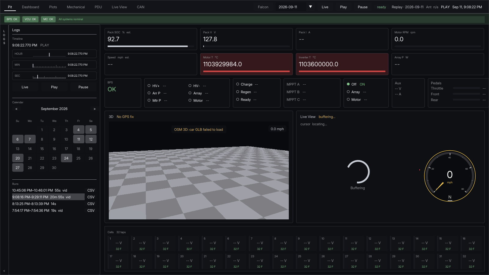
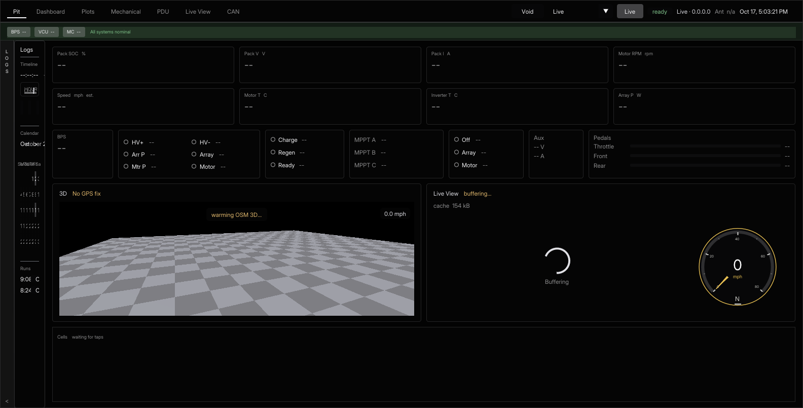

<h1 align="center">Photon</h1>
<p align="center">Telemetry for the LHR solar car.</p>
<p align="center">Decoded CAN, the onboard camera, and the car on track. One playhead for every screen.</p>

<p align="center">
  <a href="https://lhr-solar.github.io/photon-mono/">Project page</a>
</p>

<p align="center">
  
</p>

Pit during a saved run. Logs is open on the left: the timeline, the calendar, and the runs from that day.

<p align="center">
  
</p>

Pit with Logs closed, before a car is connected.

The same page is published with the Cayman theme at [lhr-solar.github.io/photon-mono](https://lhr-solar.github.io/photon-mono/).

## Screens

Pit is the home screen. Pack state, contactors, cell taps, the camera, and the 3D view sit on one page. The other screens are Dashboard, Plots, Mechanical, PDU, Live View, and CAN. Dynamics is a tab inside Mechanical.

Logs picks the run and the playhead. Charts on Mechanical draw the last 15 seconds at that playhead. Move the playhead before you decide a channel is dead.

Plots is where a chart needs a different shape. Export a CSV from the open run when the stint needs a spreadsheet.

## Run

```text
photon build
photon server
photon ui local
photon ui daq HOST[:PORT]
photon ui oracle
photon ui pcan
photon ui log RECORDING_ID
photon station
```

`photon server` accepts CAN on port 6100 and serves the page and `/ws` on port 8080. `photon build` writes the server, the page, the PCAN adapter, and the offline exporter into `build\`.

`photon-server` owns ingest, recordings, DBC decoding, browser sessions, replay, and video. `photon-next` is the display client, as `photon.html` or `photon-ui`. See [the server readme](photon-server/readme.md) and [the photon-next readme](photon-next/README.md).

`Photon/` is a separate repository. That tree is the native desktop client.
