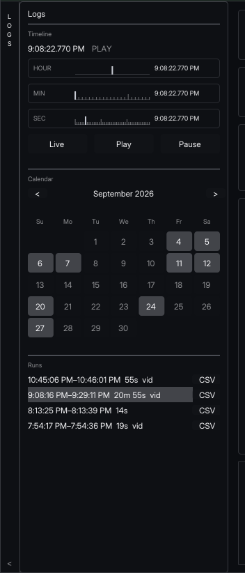

# Logs

Every chart, the camera, and the 3D car share one playhead. Mechanical does not have its own time scrub. **LOGS** is where you move time.

The vertical LOGS tab is on the left edge. Open it before you trust an empty chart.

## The four modes

The clock above the bars is the playhead. The word beside it is the mode.

| Mode | What it means |
| --- | --- |
| LIVE | The page is following the car. Charts show the last 15 seconds. |
| PLAY | A saved run is walking forward from the playhead. |
| PAUSE | The run is held. Charts show the 15 seconds that end here. |
| BUFFERING | The page is still fetching that moment. Wait for PLAY or PAUSE before you read a spike. |

Three buttons sit under the timeline bars:

- **Live** leaves the recording and returns to the car.
- **Play** walks the open run forward. If nothing is selected yet, it starts at the beginning of the run.
- **Pause** holds the playhead.

## Open a run

The calendar lists days that have data. Pick the day, then click the run under it. Hover a run to see its id and how many samples it holds. Run ids look like `20260905-192036-00`.

Clicking a run starts playback. Drag the hour bar, then the minute bar, then the second bar to move through that run. Each drag pauses on the new time, so the camera and the charts land on the same moment.

`vid` on a run means that run has camera. **CSV** on the row exports that run. The export itself is [Export a CSV](/export.html).

::: tip
A click on a Plots chart also moves this playhead and pauses the run. Dragging inside a Plots chart pans the window and does not seek. Mechanical charts do not do either. They only follow LOGS.
:::

## Read a moment

1. Open the run.
2. Pause on the braking zone or the corner you were asked about. Use the clock, not a guess at the bar.
3. Stay on Mechanical, or open Live View if you want the camera large.
4. The Mechanical charts are the 15 seconds ending at that clock. Step the second bar if the event is shorter than the window.

`No samples in selected time window` and a readout of `--` mean this 15 second slice has no sample for that channel. Scrub into a part of the run where the car was moving before you call the sensor dead. A channel that is `--` for the whole run is a different problem. Check [Signal names](/signals.html) and the CAN tab.

## Camera

Race context and Live View play the camera at the same playhead. Some runs have CAN and no overlapping camera. The picture stays empty for that run. The traces are still valid. Do not wait on the video if the clock is already in the stint and the charts are moving.

## Back to the car

**Live** returns to the car. Confirm the mode reads LIVE and that speed or throttle is changing before you treat the page as live. A paused run looks filled-in and still. Live looks filled-in and moving.

You can change screens while a run is playing. The clock keeps moving. Pause first when you want a still frame and a chart of the same moment.
