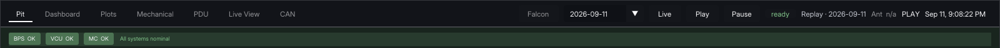

# Top bar

The names on the left are the screens. The underlined name is the one you are on. Click another name to move. Changing screens does not move the playhead.

| You want | Open |
| --- | --- |
| Pack, contactors, and whether the car is ready | [Pit](/pit.html) |
| Faults, coolant, motor limits, and the cell grid | [Dashboard](/dashboard.html) |
| One channel, or a longer window | [Plots](/plots.html) |
| Pedals, brakes, suspension, yaw, wheels, and the G-G | [Mechanical](/mechanical/) |
| A switched 12 V channel | [PDU](/pdu-and-can.html) |
| The camera and the 3D car, full size | [Live View](/live-view.html) |
| Whether a message is on the bus, and its rate | [CAN](/pdu-and-can.html) |

On the right are the car name, the day, and Live, Play, and Pause. The clock at the far right is the moment the whole page is showing. PLAY means a saved run is walking forward. `ready` means the page is connected.

The green row under the names is BPS, VCU, and MC. OK means that controller is talking.

After a stint, follow [Test day](/test-day.html).
